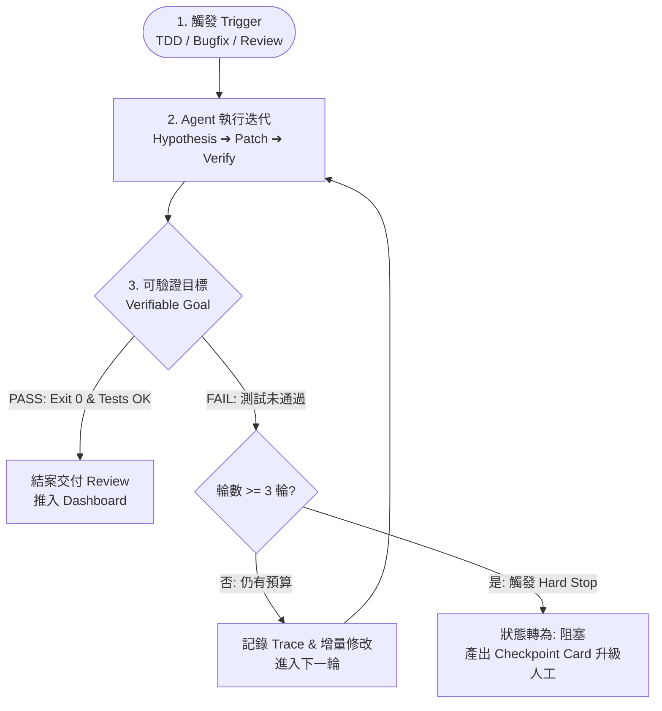

# Feature Spec: Loop Engineering 工作流與可觀測性架構規範

- **版本**：v1.0.0
- **日期**：2026-10-14
- **狀態**：已簽核 (Approved)
- **領域**：Loop Engineering / Agent-in-the-Loop Workflow / Token Optimization & Observability
- **檔案位置**：`.github/harness/spec/loop-engineering-workflow-spec.md`

---

## 1. 摘要與典範轉移 (Summary & Paradigm Shift)

傳統 AI 開發協作主要採 **Prompt Engineering (Human-in-the-loop)** 模式：由人類下達指令，AI 產出，人類閱讀成果、找出錯誤並人工下達修正指令，整個迭代循環依賴人類頻繁推動。

**Loop Engineering** 則是一種從「Human-in-the-loop」轉向「**Agent-in-the-loop**」的工程範例：將「審核、回饋與修正」的邏輯標準化與程式化，讓 AI 代理在受控的迴圈中自主執行、測試、讀取錯誤並修正，直到達成明確、客觀可驗證的目標。

本規範結合 `plan-to-build` 現有的 11 大核心 Skill 與 Harness 自動化工具鏈，定義 Loop Engineering 工作流架構，並設計嚴格的防禦機制（Hard Stop、變更隔離、獨立審查）以杜絕 Token 黑洞，同時提供完整的可觀測性（Trace Logs 與 Dashboard 視覺化）以便隨時檢視產出。

---

## 2. 專案現況評估與缺口分析 (As-Is vs. To-Be)

### 2.1 現有資產優勢 (AS-IS)
1. **Harness 程式化工具箱**：`harness-cli.js` (`check`, `card`, `validate`, `verify`) 已具備 0~4 閘門檢查、Task Card 驗證與命令執行裁切能力。
2. **二元客觀判官**：`slice-judge.js` 可基於 Exit Code 0、客觀測試日誌二元判定驗收標準，杜絕主觀口頭承諾。
3. **11 大分級 Skill**：具備職責明確的工作流模組（`analyze-spec`, `plan-build`, `tdd-build`, `debugging-and-error-recovery`, `cross-model-review` 等）。
4. **現有視覺化看板**：`dashboard/` 提供基於 Vite + React + Express 的全域工作流即時監控能力。

### 2.2 現況缺口與風險 (Gaps & Risks)
| # | 現況缺口 | 潛在風險 | 本架構因應對策 |
|---|---|---|---|
| G1 | 缺乏迴圈終止硬性上限 | 陷入「Token 黑洞」，Agent 反覆修改產生高額 API 帳單 | 實作 **Hard Stop (≤ 3 次)**，逾期強制切換 `阻塞` 並升級人工 |
| G2 | 自我審核「左手轉右手」 | 作者代理自己寫代碼、自己給自己打分放行，易忽視盲點 | 綁定 Diff Hash，強制獨立 Reviewer 或客觀測試斷言 |
| G3 | 缺乏結構化執行軌跡 | 迭代中間產物覆寫，無法進行事後 Error Analysis 與追蹤 | 建立 **Append-only Trace Log** (`history.jsonl` / `loop-state.json`) |
| G4 | 迴圈黑箱無可觀測性 | 開發者無法快速得知當前跑第幾輪、改了什麼、為何失敗 | 擴充 **Dashboard 視覺化面板** (Timeline, Diff, 收斂圖) 與 CLI 檢視 |

---

## 3. Loop Engineering 三大核心支柱 (Core Pillars)



### 3.1 觸發機制 (Trigger)
- **TDD 紅綠重構循環 (`tdd-build`)**：
  - 階段 1 (Red)：撰寫失敗測試，驗證 Exit Code ≠ 0 且錯誤訊息符合預期。
  - 階段 2 (Green Loop)：實作最小代碼，迴圈執行測試直至通過。
  - 階段 3 (Refactor Loop)：代碼重構，確保測試持續綠燈。
- **自動除錯修復迴圈 (`debugging-and-error-recovery`)**：
  - 捕獲 Error/StackTrace ➔ 提出假說 (Hypothesis) ➔ 最小 Patch ➔ 執行驗證命令。
- **獨立模型審查迴圈 (`cross-model-review`)**：
  - 提出修改 ➔ 獨立審查者檢查盲點 ➔ 針對 Finding 修正 ➔ 重新驗證。

### 3.2 客觀可驗證目標 (Verifiable Goal)
- 禁止使用模糊描述（如「程式碼感覺乾淨了」、「UX 變順了」）。
- 必須是**機器可判定之二元標準 (Binary Checklist)**：
  1. 測試套件執行 Exit Code == 0。
  2. 零 Lint / Type-Check 錯誤。
  3. 產出之 Diff 位於宣告的受影響檔案清單內（Forbidden files 零異動）。
  4. 滿足 Feature Spec 之驗收條目。

### 3.3 硬性終止條件與人工升級 (Hard Stop & Human-in-the-Loop)
- **單一問題最大嘗試上限**：預設為 **3 輪**。
- **邊界隔離**：單輪 Diff 行數上限或特定系統核心檔保護。
- **升級機制 (Escalation Protocol)**：
  - 當第 3 輪仍未通過，立即中斷迴圈。
  - 將 `.github/worklog/agent-status.md` 的狀態切換為 `阻塞`。
  - 生成包含「3 次嘗試之假設、修復措施、錯誤訊息與建議恢復點」的結構化 Checkpoint Card，等待工程師裁決。

---

## 4. 可觀測性與產出檢視架構 (Observability & Reviewability)

### 4.1 結構化執行軌跡 (Append-only Trace Log)
每次 Loop 執行與狀態躍遷均即時記錄於專案 `.github/worklog/`：
- **`loop-state.json`**：當前 Active Loop 快照（任務 ID、目前輪次、最大輪次、各輪假說與判定結果）。
- **`history.jsonl`**：Append-only 永久歷史日誌，格式規範：
  ```json
  {
    "timestamp": "2026-10-14T11:00:00.000Z",
    "taskId": "TASK-113",
    "iteration": 1,
    "hypothesis": "Fix status term validation in agent-status.md",
    "command": "npm test",
    "exitCode": 0,
    "verdict": "PASS",
    "diffSummary": "1 file changed, 1 insertion(+), 1 deletion(-)",
    "tokensEstimate": 1500
  }
  ```

### 4.2 Dashboard 視覺化面板擴充
於專案 `dashboard/` 提供 Loop 專屬觀測介面：
1. **Iteration Timeline**：以時序流展示每一輪嘗試的假說 (Hypothesis)、耗時與測試結果標記（綠燈 PASS / 紅燈 FAIL）。
2. **Diff Inspector**：並列比對每一輪前後的程式碼變更差異，確保沒有非預期的架構破壞。
3. **Convergence Graph**：統計測試通過率、錯誤數量變化曲線，直觀確認迴圈是否朝正確方向收斂。

### 4.3 CLI 快速診斷 (`harness-cli loop`)
提供無頭終端即時檢視子指令：
- `npm run harness:loop` 或 `node .github/scripts/harness-cli.js loop status`：輸出當前 Loop 狀態、輪次進度條與最近結果。
- `node .github/scripts/harness-cli.js loop step --hypothesis="..." --cmd="..."`：執行一輪迴圈並自動記錄 Trace。
- `node .github/scripts/harness-cli.js loop reset`：重置或歸檔當前 Loop。

---

## 5. 完成定義 (Definition of Done)
1. 規格書完整簽核並納入 `.github/harness/spec/loop-engineering-workflow-spec.md`。
2. `harness-cli.js` 實作 `loop` 子指令，涵蓋 status、step（含 Hard Stop 限制）與 reset。
3. `dashboard/server/parser.ts` 擴充支援解析 `loopState` 與 `history.jsonl`。
4. `harness-cli.test.js` 新增單元測試，驗證 Hard Stop 攔截率達 100%，全量測試 Exit Code 0 通過。
