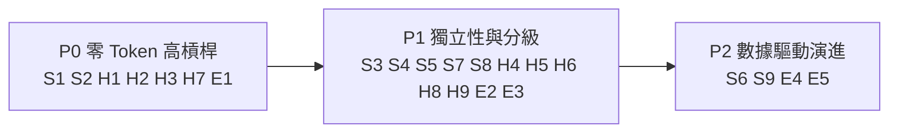

# Skill 與 Harness Workflow 優化建議書

- **日期**：2026-10-08
- **任務**：PROP-2026-10-08（micro，文件產出、無行為影響）
- **依據**：Obsidian 知識庫 `KnowledgeBase/`（AI 筆記 + plan-to-build 專案筆記）× 本 repo 現況稽核
- **狀態**：草案，待使用者決定採納項目

## 目錄

1. [摘要](#1-摘要)
2. [參考筆記來源](#2-參考筆記來源)
3. [現況稽核：有證據的缺口](#3-現況稽核有證據的缺口)
4. [Skill 層建議（S1–S9）](#4-skill-層建議s1s9)
5. [Harness 層建議（H1–H9）](#5-harness-層建議h1h9)
6. [Evals 層建議（E1–E5）](#6-evals-層建議e1e5)
7. [優先順序路線圖](#7-優先順序路線圖)
8. [不建議採納的做法](#8-不建議採納的做法)
9. [Agent Handoff Protocol](#9-agent-handoff-protocol)

---

## 1. 摘要

上一個 Sprint（AI Evals MVP）已經把三件事做到「可以用確定性方式判定」：Phase 斷言、Router 校準、切片判定。這次對照筆記後，剩下的缺口主要有三類：

1. **Skill 文件不好讀（可讀性 / 可定位性）**：25 個 `SKILL.md` 有 12 個超過 200 行，但**沒有一個有目錄 (TOC)**。不過 `harness-workflow.md` 卻要求 agent「長 skill 先讀目錄」，規則和現況互相矛盾。
2. **守門機制大多還停在文件上，沒有真的強制執行**：文件提到 Stop Hook，但 repo 裡沒有 hook 設定。Cross-model review 的通過標記由作者自己蓋，也允許同一個模型換個 persona 來審，形成筆記說的「左手轉右手」。
3. **評測結果可能太樂觀**：`eval-router.js` 驗的是**手寫的關鍵字模擬器**，不是 LLM 讀了 `AGENTS.md` 之後實際怎麼路由。而且規則是在看過 20 筆資料集之後才寫的，TPR/TNR 100% 有過擬合 (Goodhart's Law) 的風險。

建議採三階段處理：P0 是零 Token、1–2 天可完成、槓桿最高的項目；P1、P2 再逐步加深。

---

## 2. 參考筆記來源

| 主題 | 筆記 | 用在哪些建議 |
| --- | --- | --- |
| 現代 Skill 7 原則 | [現代 Agent Skills 架構設計與防禦實踐](file:///Users/nelsonchung/Library/Mobile%20Documents/iCloud~md~obsidian/Documents/KnowledgeBase/Wiki/Knowledge/AI/現代%20Agent%20Skills%20架構設計與防禦實踐.md) | S1–S5 |
| Matt Pocock v1.3 | [Matt Pocock Skills v1.3 重點筆記](file:///Users/nelsonchung/Library/Mobile%20Documents/iCloud~md~obsidian/Documents/KnowledgeBase/Raw/Matt%20Pocock%20Skills%20v1.3%20重點筆記.md) | S6–S9、H1 |
| Matt Pocock 工作流 | [Matt Pocock AI 開發工作流與防禦性工程實踐](file:///Users/nelsonchung/Library/Mobile%20Documents/iCloud~md~obsidian/Documents/KnowledgeBase/Wiki/Knowledge/AI/Matt%20Pocock%20AI%20開發工作流與防禦性工程實踐.md) | H8 |
| MAPS 四層架構 | [將 Claude Code 打造為專屬 AI 作業系統](file:///Users/nelsonchung/Library/Mobile%20Documents/iCloud~md~obsidian/Documents/KnowledgeBase/Raw/將%20Claude%20Code%20打造為專屬%20AI%20作業系統（MAPS%20四層架構）.md) | H1、H2、H6、H7、S5 |
| Cross Model Review | [Cross Model Review 自動化工作流](file:///Users/nelsonchung/Library/Mobile%20Documents/iCloud~md~obsidian/Documents/KnowledgeBase/Wiki/Knowledge/AI/Cross%20Model%20Review%20自動化工作流.md) | H3、H4 |
| Loop Engineering | [Loop Engineering 核心概念與應用](file:///Users/nelsonchung/Library/Mobile%20Documents/iCloud~md~obsidian/Documents/KnowledgeBase/Wiki/Knowledge/AI/Loop%20Engineering%20核心概念與應用.md) | H5、§8 |
| AI Evals | [AI 評估體系建構指南](file:///Users/nelsonchung/Library/Mobile%20Documents/iCloud~md~obsidian/Documents/KnowledgeBase/Wiki/Knowledge/AI/AI%20評估體系建構指南.md) | E1、E2、E5 |
| SkillOpt | [SkillOpt 與 Langfuse 的 Agent 技能優化架構](file:///Users/nelsonchung/Library/Mobile%20Documents/iCloud~md~obsidian/Documents/KnowledgeBase/Wiki/Knowledge/AI/SkillOpt%20與%20Langfuse%20的%20Agent%20技能優化架構.md) | S2、E3 |
| Test Sentinel | [Test Sentinel 變異防禦與 AI 評測心法](file:///Users/nelsonchung/Library/Mobile%20Documents/iCloud~md~obsidian/Documents/KnowledgeBase/Wiki/Knowledge/AI/Test%20Sentinel%20變異防禦與%20AI%20評測心法.md) | E1、E4 |
| Prompt / Brief | [Prompt Engineering](file:///Users/nelsonchung/Library/Mobile%20Documents/iCloud~md~obsidian/Documents/KnowledgeBase/Wiki/Knowledge/AI/Prompt%20Engineering.md) | S2、H9 |
| CDLC | [AI 編程時代的致命盲區與開發者生存指南](file:///Users/nelsonchung/Library/Mobile%20Documents/iCloud~md~obsidian/Documents/KnowledgeBase/Wiki/Knowledge/AI/AI%20編程時代的致命盲區與開發者生存指南.md) | S8 |
| 上一輪回顧 | [2026-09-10 AI Evals MVP Retro](file:///Users/nelsonchung/Library/Mobile%20Documents/iCloud~md~obsidian/Documents/KnowledgeBase/Wiki/Projects/plan-to-build/retro/2026-09-10-ai-evals-mvp-retro.md) | H3、E1（未完成 Action 2–4） |

---

## 3. 現況稽核：有證據的缺口

| # | 檢查項目（筆記原則） | 現況證據 | 判定 |
| --- | --- | --- | --- |
| A1 | 超過 100 行的文件要有 TOC | 25 個 SKILL.md 有目錄的數量是 **0**，其中 12 個超過 200 行（最長是 `post-launch-optimization` 323 行）；`harness-workflow.md` 340 行，也沒有 TOC | ❌ |
| A2 | 規則與現況一致 | [harness-workflow.md#L51](file:///Users/nelsonchung/projects/plan-to-build/.github/harness/harness-workflow.md#L51) 寫「先讀目錄/標題附近段落」，但沒有任何文件有目錄 | ❌ 矛盾 |
| A3 | 在 frontmatter 註明建議模型 / 自由度 | 25 個 skill 都沒有 `models` 或 `freedom` 欄位 | ❌ |
| A4 | 引用路徑扁平且有效 | [write-tests/SKILL.md#L24-L26](file:///Users/nelsonchung/projects/plan-to-build/.github/skills/write-tests/SKILL.md#L24-L26) 指向 `docs/design/`、`docs/plan/`，但 harness 的固定路徑是 `.github/harness/design|plan/` | ❌ 路徑漂移 |
| A5 | AGENTS.md 精簡（Matt v1.3：不要讓它膨脹） | [AGENTS.md](file:///Users/nelsonchung/projects/plan-to-build/AGENTS.md) 134 行，每次對話都會載入，裡面有「三大省 Token 目標」「Matt Pocock 整合說明」這類背景敘述 | ⚠️ |
| A6 | Stop Hook 由程式強制執行 | `.claude/` 底下沒有 `settings.json` hooks，也沒有 git pre-commit；Retro Action 2 還沒做 | ❌ 只停在文件 |
| A7 | Reviewer 真的獨立 | [cross-model-review/SKILL.md](file:///Users/nelsonchung/projects/plan-to-build/.github/skills/cross-model-review/SKILL.md) 允許「嚴格切換角色」，而且標記由作者自己蓋；標記沒有綁定任何 diff | ❌ 左手轉右手 |
| A8 | Router 評測量的是真實行為 | [eval-router.js#L17-L60](file:///Users/nelsonchung/projects/plan-to-build/.github/scripts/eval-router.js#L17-L60) 的 `resolveIntent()` 是關鍵字加 Regex 的模擬器；資料集沒有分 holdout | ⚠️ 過擬合風險 |
| A9 | 記錄採 append-only，保留軌跡 | `agent-status.md` 每換一個任務就整份覆寫，舊任務的 Evidence 只能從 git 歷史找回 | ⚠️ 不利 Error Analysis |
| A10 | Retro「修環境，不修程式碼」 | [retrospective-and-learnings/SKILL.md](file:///Users/nelsonchung/projects/plan-to-build/.github/skills/retrospective-and-learnings/SKILL.md) 沒有分流規則（機械規則→lint/CI，設計裁量→standards） | ⚠️ |
| A11 | Retro 待辦閉環 | Retro Action 2（pre-commit）、3（資料集擴到 50 筆）、4（prisma devDep）都還沒完成 | ⚠️ |

---

## 4. Skill 層建議（S1–S9）

### S1. TOC 先行，並寫成驗證規則〔P0〕
- **筆記依據**：工具常只預覽 `head -100`，100 行之後的規則等於不存在。
- **做法**：
  1. 超過 100 行的 `SKILL.md`、`harness-workflow.md`、`harness-workflow-appendix.md`，頂部一律加 `## 目錄`。
  2. 在 [validate-skills.js](file:///Users/nelsonchung/projects/plan-to-build/.github/scripts/validate-skills.js) 新增規則：`lines > 100 && !/^## 目錄/m` 時以 exit 1 失敗。
- **驗收（二元）**：`node .github/scripts/validate-skills.js` 的 exit code 為 0，而且新規則有 Red→Green 單元測試。

### S2. 前 30 行放硬性規則，結尾再錨定一次〔P0〕
- **筆記依據**：Prompt Engineering 的「重申關鍵指令」；SkillOpt 的「末端注意力錨點」。
- **做法**：每個 SKILL.md 依固定順序排版：frontmatter → `## 目錄` → `## 硬性規則 (Must)`（最多 5 條，用 RFC 2119 的 Must/Should/May 標示）→ 流程 → 範例 → `## 完成前檢核`（把 Must 重述一次，改成 checklist）。範本同步更新 [SKILL-TEMPLATE.md](file:///Users/nelsonchung/projects/plan-to-build/docs/templates/SKILL-TEMPLATE.md)。
- **驗收**：validate 檢查 `## 硬性規則` 出現在前 40 行，`## 完成前檢核` 出現在最後 1/3。

### S3. frontmatter 加上 `freedom` 自由度分級〔P1〕
- **筆記依據**：自由度矩陣（Low / Medium / High）。高階模型被管得太細時，表現反而下降。
- **做法（初步分級）**：

| freedom | Skills | 寫法 |
| --- | --- | --- |
| `low` | git-commit、security-and-hardening、shipping-and-launch、ci-cd-and-automation | 給完整指令，禁止自行增減參數 |
| `medium` | analyze-spec、plan-build、tdd-build、write-tests、code-review-and-quality、documentation-and-adrs | 給範本和限制，細節可以調整 |
| `high` | idea-refine、grill-me、debugging-and-error-recovery、design-architecture | 只給目標和評估標準，**刪掉逐步微觀指令** |

- **驗收**：validate 要求 `freedom ∈ {low, medium, high}`；`low` 的 skill 必須至少有一個 fenced code block 提供可直接執行的指令。

### S4. frontmatter 加 `models-tested`，並做跨模型冒煙測試〔P1〕
- **筆記依據**：Test on Every Model First。小模型用來驗步驟是否完整，大模型用來驗是否管得太細。
- **做法**：每個 skill 註記 `models-tested: [flash, sonnet, opus]`。配合 AGENTS 目標 3 (Model Routing)，讓 `micro` 任務可以安全交給 flash 級模型。
- **驗收**：核心路徑 5 個 skill（analyze-spec、plan-build、tdd-build、code-review、git-commit）各有一份跨模型冒煙紀錄，放在 `docs/evaluations/`。

### S5. 單層引用，並自動檢查連結〔P1〕
- **筆記依據**：One level deep；MAPS 的 nightly checker（避免孤兒路徑）。
- **做法**：validate 解析每個 SKILL.md 的相對連結與反引號路徑，確認檔案存在；`references/*.md` 不得再引用其他 references。同時修正 A4 的 `docs/design/` 路徑漂移。
- **驗收**：連結檢查 0 失敗；在 CI ([validate-skills.yml](file:///Users/nelsonchung/projects/plan-to-build/.github/workflows/validate-skills.yml)) 中執行。

### S6. Skill 精簡盤點〔P2〕
- **筆記依據**：Matt v1.3 移除 `resolving-merge-conflicts`，理由是現行模型已經會處理。
- **做法**：先記錄使用量（見 H7 的 log），累積 4 週後再列出候選。預先觀察的對象：`post-launch-optimization`（最長，和 retro / shipping 職責重疊）、`code-simplification`（可能和 code-review 重疊）。**現在不刪**，等使用量數據出來再決定。
- **驗收**：產出一份附使用量數據的盤點表，並由使用者決策。

### S7. 新增 PR 說明能力（`/pr`）〔P1〕
- **筆記依據**：Matt v1.3 `/pr` 的三塊結構：視覺化摘要、前後證據、合併危險度（單向門 / 雙向門）。
- **做法**：寫進 `git-commit` skill 的一個段落，或另開 `pr-description` skill。Evidence 欄位直接引用 slice-judge 已驗證過的命令輸出，避免出現「我讀過程式碼，應該沒問題」這類說法。
- **驗收**：PR 範本有三個必填段落；`Merge Danger` 欄位只能填 `one-way` 或 `two-way`。

### S8. Retro 升級為「修環境」並分流〔P1〕
- **筆記依據**：Matt v1.3 `/retro`；CDLC「溯源修 agent.md，而不是直接改程式碼」。
- **做法**：在 retrospective skill 加入分流表：
  - 機械性規則（命名、禁用 API、路徑）→ 寫進 `validate-skills.js`、lint 或 CI
  - 設計裁量 → 寫進 `CODING_STANDARDS.md`（只給 review agent 讀，不常駐載入）
  - 只有跨任務通用、而且每次都需要的規則，才進 `AGENTS.md`
  - 由人勾選要採納哪些（HITL），禁止全自動寫入
- 路由上，把 retro 排在 `code-review-and-quality` 或 `debugging-and-error-recovery` 之後，作為收尾步驟。
- **驗收**：retro 產出的每個 Action 都標了去向（`lint|standards|agents|drop`）。

### S9. 建立 `GLOSSARY.md`〔P2〕
- **筆記依據**：Matt 用精準領域術語作為壓縮的 Prompt（v1.3 已把 CONTEXT.md 改名為 GLOSSARY.md）。
- **做法**：收錄切片、Evidence、Handoff、Stop Hook、Marker、TPR/TNR、micro/standard/heavy 等詞，每詞 1–2 行；狀態詞彙仍以 `harness-status-dictionary.md` 為準，GLOSSARY 只放連結。
- **驗收**：Skills 裡第一次出現這些術語時，不再各自重新定義。

---

## 5. Harness 層建議（H1–H9）

### H1. AGENTS.md 精簡成「主路標檔」〔P0〕
- **筆記依據**：MAPS 主路標檔建議 40–60 行，只放路由不放細節；Matt v1.3 提醒避免 AGENTS.md 膨脹。
- **做法**：把「三大省 Token 目標」「Matt Pocock 整合說明」移到 README 或 `docs/`；Task Card 範本只留一行連結指向 `.github/harness/templates/`。只保留：讀取順序、四閘門（各一行）、路由表、負向排除、全域鐵律。
- **驗收**：`AGENTS.md` ≤ 80 行；精簡後 `npm run eval:router` 仍然 PASS（負向排除的段落不能被刪掉）。

### H2. 兩跳尋址〔P0〕
- **筆記依據**：任何事實都要能從主地圖在兩步跳轉內找到。
- **做法**：`AGENTS.md` → `harness-workflow.md`（頂部 TOC 加上每節一行摘要）→ 目標章節或 appendix。`agent-reference.md`、`harness-workflow-appendix.md` 不得再引用第三層文件。
- **驗收**：S5 的連結檢查同時涵蓋 harness 目錄，而且沒有深度超過 2 的引用鏈。

### H3. 把 Stop Hook 做成真的〔P0〕
- **筆記依據**：「設計不依賴紀律的攔截器」；Retro Action 2。
- **做法**：
  1. Git 層：用 `simple-git-hooks` 註冊 pre-commit，內容是 `npm run harness:validate && npm run judge:slice`。
  2. Agent 層：新增 `.claude/settings.json` 的 `Stop` hook，在 `Status: 已完成` 但 validate 失敗時阻止收工（其他工具則用 pre-commit / CI 替代）。
- **驗收**：故意寫入一筆只有口頭承諾的 Evidence，`git commit` 要被擋下（exit 1）；修正後才可以 commit。

### H4. Reviewer 獨立性，並把 Marker 綁定 diff〔P1〕
- **筆記依據**：自己審自己會「視而不見」；Marker 是 hook 和 skill 之間的握手暗號。
- **做法**：
  1. `heavy` 任務禁止用同一模型換 persona 的方式審查，必須用不同供應商 / 模型（例如透過 [cross-model-reviewer.js](file:///Users/nelsonchung/projects/plan-to-build/.github/scripts/cross-model-reviewer.js)）。
  2. Marker 格式擴充為 `> [!CHECK] Cross-Model Review Approved by <model> @ diff:<sha256 前 12 碼>`，由 reviewer 腳本寫入，作者不得手動蓋章。
  3. `slice-judge` 檢查 marker 的 diff hash 是否等於目前 diff；若 diff 已變動，marker 自動失效。
- **驗收**：手動偽造的 marker，或 diff 已變動後殘留的 marker，都要被 slice-judge 判定為 FAIL。

### H5. 迴圈要有硬性停止條件〔P1〕
- **筆記依據**：Loop Engineering 的 Token 黑洞；需要 Hard stop 和 HITL。
- **做法**：在 harness 寫明：同一個錯誤修復迴圈最多 3 次嘗試，第 3 次仍失敗就自動轉 `阻塞`，並附上三次嘗試的假設與證據。Cross-model review 仍然**不設輪數上限**，因為輪數上限會逼 reviewer 隨便放行；但每一輪都必須有新證據或新論點，連續兩輪沒有新內容就升級給人決策。
- **驗收**：harness-workflow 的「命令失敗即時中斷」段落補上次數上限與升級格式。

### H6. 完成權歸人：新增 `待驗收` 狀態〔P1〕
- **筆記依據**：MAPS 第 1 條準則「Claude 不得擅自將任務標記為完成」。
- **做法**：`heavy` 任務由 agent 只能推到 `待驗收`，使用者確認後才變成 `已完成`；`micro`/`standard` 維持現行流程，以 slice-judge PASS 為準。狀態字典與 slice-judge 同步更新。
- **驗收**：`heavy` 任務如果由 agent 直接寫 `已完成`，又沒有使用者確認紀錄，validate 判 FAIL。

### H7. Append-only 執行軌跡〔P0〕
- **筆記依據**：MAPS「儲存檔一律追加寫入」；AI Evals「沒有 trace 就沒有 Error Analysis」。
- **做法**：`agent-status.md` 維持「目前快照」（可以覆寫）。另外新增 `.github/worklog/history.jsonl`，由 `harness-cli` 在每次狀態轉換時追加一行：`{ts, taskId, tier, route, from, to, evidence, skillsLoaded}`。
- **驗收**：狀態轉換後 JSONL 行數 +1；有測試確認不會整檔覆寫。這也是 S6、E2 的數據來源。

### H8. 切片一律採功能垂直切分〔P1〕
- **筆記依據**：Matt `to-tickets`：依使用者功能切，不依技術層切。
- **做法**：在 `plan-build` 的 Must 規則加一條「每個切片都必須能獨立驗收（含它自己的 UI / API / 資料）」；build-plan 範本中，每個切片新增「獨立驗收命令」欄位。
- **驗收**：build-plan 裡每個切片都有可執行的驗收命令。

### H9. Input 收斂閘門改用 Brief 五欄位〔P1〕
- **筆記依據**：Prompt Engineering 的 Brief：目標 / 背景 / 素材 / 邊界 / DoD。
- **做法**：現行閘門只檢查目標、範圍、驗收。補上兩欄：**素材**（可以用、不可以用的來源，「找不到就留白」）和**邊界**（不准碰的檔案或行為）。`harness-cli card` 輸出同步調整。
- **驗收**：`card --ai` 輸出包含 5 欄；缺「邊界」時標 `需補充輸入`。

---

## 6. Evals 層建議（E1–E5）

### E1. Router 評測去過擬合〔P0〕
- **筆記依據**：Goodhart's Law；AI Evals 的「評估集要定期抽新資料」。
- **現況風險**：`resolveIntent()` 是看過資料集後才寫的規則，100% 只能說明規則記住了這 20 筆，不能說明 LLM 實際路由會正確。
- **做法**：
  1. 把資料集擴充到 50 筆（Retro Action 3），拆成 `train`（可以拿來調規則）和 `holdout`（不得拿來調規則），報告分開列出兩組的 TPR/TNR。
  2. 新增 `--llm` 模式：用實際模型把 `AGENTS.md` 當 system prompt 來分類，每週或每次修改 AGENTS.md 時手動跑一次；平常 CI 仍跑零 Token 的模擬器。
  3. 在報告中誠實標示「模擬器結果」和「LLM 結果」是兩個不同的數字。
- **驗收**：holdout 的 TPR ≥ 80% 且 TNR ≥ 80%；`--llm` 模式至少有一份基準報告。

### E2. 多 Skill 的觸發混淆矩陣〔P1〕
- **筆記依據**：二元判定 + TPR/TNR，Negative Eval。
- **做法**：把 router 評測從二元（plan-to-build / other）擴充為 25 類 skill，特別針對容易混淆的組合：`idea-refine`/`grill-me`/`analyze-spec`、`code-review-and-quality`/`cross-model-review`、`retrospective`/`post-launch-optimization`。依結果修改各 skill 的 `description`。
- **驗收**：易混淆組合兩兩之間的誤判率 ≤ 20%。

### E3. Skill 產物的確定性斷言〔P1〕
- **筆記依據**：「存在 ≠ 正確」；零 Token 優先。
- **做法**：把 `assert-phase.js` 的模式套用到 harness 產物上，例如 spec 必須有 `驗收標準` 且 ≥ 3 條、build-plan 每個切片都有 `Skill Route` 和驗收命令、Handoff 4 節都要齊全。
- **驗收**：`harness-cli validate` 涵蓋 spec / plan / handoff 三類產物。

### E4. 用變異樣本校準判官〔P2〕
- **筆記依據**：Test Sentinel：變異測試就是零人工標註的 Ground Truth。
- **做法**：自動產生「刻意改壞」的 Evidence 和 status 樣本，例如把 exit code 改成非 0、刪掉命令、改成口頭承諾、marker 的 hash 不符，用來量測 `slice-judge` 的 TPR；再拿未改動的合法樣本量測 TNR，連跑 5 次都必須是 100%。
- **驗收**：slice-judge 的變異擊殺率 ≥ 90%，基線 TNR = 100%。

### E5. 人工 SkillOpt 迴圈〔P2〕
- **筆記依據**：SkillOpt 的 Rollout → Reflection → 文字學習率 → Validation Gate → Rollback。
- **做法**：先**手動**跑，不接 API 自動化。每次從 H7 的 trace 挑出失敗案例，一次最多改 2 條規則，重跑 E1/E2/E3；指標下降就 revert，並把失敗的嘗試記到 `docs/evaluations/skillopt-rejected.md`，避免重複走同一條路。
- **驗收**：每次 skill 規則修改的 commit 都附上修改前後的指標。

---

## 7. 優先順序路線圖

| 階段 | 項目 | 預估 | 成功指標（二元） |
| --- | --- | --- | --- |
| **P0** | S1 TOC 規則、S2 Must 前置、H1 AGENTS ≤ 80 行、H2 兩跳、H3 實裝 hook、H7 history.jsonl、E1 holdout | 1–2 天 | validate 新規則全綠；偽造的 Evidence 被 pre-commit 擋下；holdout 報告產出 |
| **P1** | frontmatter 分級、連結檢查、/pr、retro 分流、marker 綁 diff、迴圈上限、`待驗收`、垂直切片、Brief 五欄、多類混淆矩陣、產物斷言 | 1 週 | 偽造 marker 被判 FAIL；易混淆組合誤判率 ≤ 20% |
| **P2** | Skill 精簡盤點、GLOSSARY、變異校準、人工 SkillOpt | 累積 4 週數據後 | slice-judge 擊殺率 ≥ 90%；盤點表經使用者決策 |

> [!IMPORTANT]
> P0 裡的 H3、E1、H7 會改到程式（`.github/scripts/`），依 AGENTS.md 屬於 `standard` 任務，必須走 `plan-build` → `tdd-build`（先 Red 後 Green），完成後要做 `code-review-and-quality`。

---

## 8. 不建議採納的做法

| 筆記中的做法 | 不採納的理由 |
| --- | --- |
| MAPS 的 Agent / Pulse / Screen 層（VPS 常駐、Cron 例行程序、Brain Graph 儀表板） | 本 repo 定位是本地 workflow 框架，不是個人 OS；只取 Memory 層的路標與 checker 概念（H1、H2、S5） |
| 全自動 SkillOpt（API + Langfuse 批量迴圈） | Loop Engineering 警告的 Token 黑洞；目前資料集太小，容易過擬合。先做手動版（E5） |
| Superpowers 式 9 步強制填表 | 和 Matt「極簡模組」的方向相反，也會加重 `micro` 任務的負擔；維持現行分級 |
| 為 cross-model review 設固定輪數上限 | 筆記明確指出這會逼 reviewer 放水；改用「沒有新證據就升級給人」（H5） |
| 把 retro 所有發現都寫進 AGENTS.md | 違反 v1.3 的原則；改走 S8 的分流 |

---

## 9. Agent Handoff Protocol

### 1. 當前階段與狀態 (Current Stage)
- **Workflow Phase**: `Spec Definition`（建議書，待決策）
- **Active Task ID**: `PROP-2026-10-08`
- **Status**: `已完成`（建議書已產出，等待使用者決定採納範圍）

### 2. 本階段完成事項與決策 (Completed Decisions & Work)
- [x] 讀完 Obsidian KnowledgeBase 中 16 篇 AI / plan-to-build 相關筆記
- [x] 稽核 repo：25 個 SKILL.md、harness 文件、eval / judge 腳本、hook 設定
- [x] 整理出 S1–S9、H1–H9、E1–E5 共 23 項建議，並排出 P0/P1/P2 優先序

### 3. 接手 Agent 執行指南 (Next Agent Actionable Guide)
- **Recommended Skill**: `plan-build`
- **Next Target File**: `.github/harness/plan/skill-harness-optimization-build-plan.md`
- **Execution Criteria**:
  - [ ] 使用者勾選要採納的項目（建議先做 P0 全部）
  - [ ] 把 P0 切成垂直切片，每片附獨立驗收命令
  - [ ] 程式變更（H3、H7、E1、S1 validator）走 `tdd-build` 的 Red→Green 流程

### 4. 關鍵風險與未決問題 (Risks & Open Questions)
- ⚠️ H1 精簡 AGENTS.md 時，可能誤刪負向排除段落，導致 router 回退；必須以 `eval:router` 作為回歸閘門。
- ⚠️ H3 的 `.claude/settings.json` Stop hook 只對 Claude Code 有效；Copilot / Antigravity 要靠 pre-commit 和 CI 補位。
- ❓ E1 `--llm` 模式要用哪個模型 / API key？需要使用者決定，並放進 `.env`。
- ❓ 未來 Obsidian 筆記和 repo `docs/retrospective/` 的同一份 retro，要以哪一邊為準 (SSOT)？建議 repo 為準，vault 只放提煉後的知識和回連。
